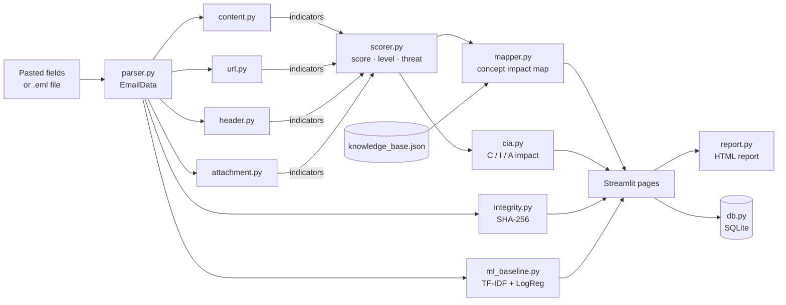
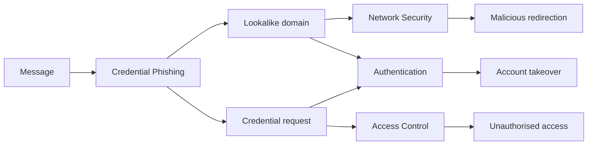

# CyberLens Architecture

## Pipeline

`core/analyzer.py` runs the whole pipeline in one function, `analyze_email(email)`. It returns a
dict with `indicators`, `score`, `impact`, `cia` and `hashes`.

## Concept Impact Map

The Analyze page draws this as a Sankey diagram. Band thickness is the indicator's weight.

## Modules

| Module | What it does |
|---|---|
| `parser.py` | Reads pasted fields or a `.eml` file (stdlib `email`) into `EmailData`: headers, text/HTML body, links (BeautifulSoup and a regex) and attachments. |
| `indicators/common.py` | The `Indicator` record, the brand list, registered-domain extraction, Levenshtein distance and lookalike detection. |
| `indicators/content.py` | 7 language checks. Each one is a list of regex phrases in the `CHECKS` table. A negation window skips warnings like "never share your OTP". |
| `indicators/url.py` | 10 link checks: HTTP, IP host, shortener, lookalike, punycode, subdomains, TLD, `@` trick, text vs href mismatch, and long/random URLs. |
| `indicators/header.py` | 8 sender checks: display name, lookalike sender, Reply-To, Return-Path, SPF/DKIM/DMARC failures, and free-mail posing as an organisation. |
| `indicators/attachment.py` | 5 file checks: dangerous extension, double extension, macro file, archive, and magic bytes vs extension. Also computes a SHA-256 per file. |
| `scorer.py` | Sums weights per category with caps (content 45, url 40, header 35, attachment 45), clipped to 100. A payload sets a floor of 40. Ordered rules pick the threat. |
| `knowledge_base.json` | Per indicator: affected concepts (with an explanation each), vulnerability, MITRE IDs, IT Act sections and recommendations. |
| `mapper.py` | Turns the indicators plus the knowledge base into concepts, MITRE, IT Act, the attack chain and Sankey data. |
| `cia.py` | Rule table: indicator → points + reason per CIA dimension. Points become levels: 0 = None, 1-2 = Low, 3-4 = Medium, 5+ = High. |
| `integrity.py` | SHA-256, constant-time verify, and the avalanche (tamper) demo. |
| `ml_baseline.py` | TF-IDF + Logistic Regression for comparison, with a generic CSV loader. |
| `evaluation.py` | Accuracy, precision, recall and F1 for rules vs ML (the ML uses 5-fold cross-validation). |
| `db.py` | SQLite history with parameterised queries, which prevents SQL injection. |
| `report.py` | Standalone HTML report. All text goes through `html.escape`, which prevents XSS. |

## Primary threat rules (first match wins)

1. Score below 25 → **Likely Safe**
2. Executable, macro, double-extension or disguised file → **Malicious Attachment**
3. Credential request or a deceptive link (lookalike, mismatch, IP, punycode, `@`) → **Credential Phishing**
4. Impersonation plus a payment request, without reward bait → **Impersonation/BEC**
5. Reward, payment or personal-data request → **Financial Fraud/Scam**
6. Otherwise → **Impersonation/BEC**

## Limitations

* English phrase lists and a small brand list.
* SPF/DKIM/DMARC are only read from existing `Authentication-Results` headers. Checking them
  directly would need DNS lookups, and the tool is offline by design.
* Polite, link-free pretexts ("Quick favour?") contain nothing to detect.
* The weights were tuned on the bundled data. Use a public dataset for an independent result.
